# Dice Cup Five Software Architecture

This document describes the implemented HTML5 application, its modules, runtime interactions, deployment, and supporting workspace files. It is an implementation-oriented architecture description.

## Contents

- [Dice Cup Five Software Architecture](#dice-cup-five-software-architecture)
  - [Contents](#contents)
  - [Scope and Architectural Constraints](#scope-and-architectural-constraints)
    - [Diagram Notation](#diagram-notation)
  - [Workspace and File Responsibilities](#workspace-and-file-responsibilities)
  - [Component and Dependency View](#component-and-dependency-view)
  - [Module Descriptions](#module-descriptions)
    - [Game Rules Module](#game-rules-module)
    - [Screen Controller Module](#screen-controller-module)
    - [Dice Scene Module](#dice-scene-module)
    - [Sound Module](#sound-module)
    - [Offline Worker and App Metadata](#offline-worker-and-app-metadata)
  - [Data Model and Class View](#data-model-and-class-view)
    - [State Records and Invariants](#state-records-and-invariants)
    - [Graphics Object Composition](#graphics-object-composition)
  - [Use Cases](#use-cases)
  - [Activity and Flow Diagrams](#activity-and-flow-diagrams)
    - [Turn Activity](#turn-activity)
    - [Score Submission Flow](#score-submission-flow)
  - [State Charts](#state-charts)
    - [Logical Game and Turn State](#logical-game-and-turn-state)
    - [Independent Presentation Lifecycle](#independent-presentation-lifecycle)
  - [Object Message Exchange Scenarios](#object-message-exchange-scenarios)
    - [Startup and Rendering Fallback](#startup-and-rendering-fallback)
    - [Keeping Dice and Rerolling](#keeping-dice-and-rerolling)
    - [Category Submission, Bonuses, and Completion](#category-submission-bonuses-and-completion)
    - [Resize and Selection Alignment](#resize-and-selection-alignment)
    - [Mute and Audio Scheduling](#mute-and-audio-scheduling)
    - [Fullscreen and Restart Controls](#fullscreen-and-restart-controls)
    - [Graphics Shutdown](#graphics-shutdown)
  - [Deployment and Offline Operation](#deployment-and-offline-operation)
    - [Deployment View](#deployment-view)
    - [Direct Source Hosting](#direct-source-hosting)
    - [Vite Development and Production Build](#vite-development-and-production-build)
    - [Worker Lifecycle State Chart](#worker-lifecycle-state-chart)
    - [Cache-First Fetch Exchange](#cache-first-fetch-exchange)
  - [Quality Attributes and Verification](#quality-attributes-and-verification)
  - [Maintenance Considerations](#maintenance-considerations)

## Scope and Architectural Constraints

Dice Cup Five is a single-player browser game. A game contains 13 turns, five dice, up to three rolls per turn, and one score in each category. The complete scoring specification is in [rules.md](rules.md).

The principal architectural decisions are:

- **Client-side execution:** game state, scoring, rendering, and audio run in the browser. There is no application backend, database, account system, or network game protocol.
- **Separation of rules and presentation:** the game module calculates outcomes; the screen module controls interaction; the scene module animates already-decided dice values.
- **Native ES modules:** source imports use relative paths. Runtime Three.js files are vendored locally rather than resolved through bare npm imports or a CDN.
- **Direct source hosting is a non-functional requirement:** a live/static HTTP server must be able to serve `./javascript/html5/src` without a build step or Vite. Production bundling is an additional deployment option, not a runtime prerequisite.
- **Progressive fallback:** WebGL initialization failure selects numeric dice controls. Missing Web Audio support simply disables synthesized sound.
- **Local state:** the current game lives in memory. Only the mute preference is explicitly persisted by the application; asset caching is handled separately by the service worker.

### Diagram Notation

The diagrams use Mermaid so they can remain editable text alongside the source. Sequence, state, and class diagrams use Mermaid's corresponding diagram types. Mermaid does not provide native UML use-case, component, deployment, or activity syntax, so those views use labeled flowcharts with UML-style system boundaries and relationships. They are architectural equivalents, not strict UML interchange files.

Class diagrams distinguish actual library classes from application **modules**, **records**, and **closure-backed objects**. The application does not define JavaScript classes for its game state or controller.

## Workspace and File Responsibilities

```text
dice5/
  .gitignore
  .vscode/
    settings.json
  AUTHORS
  README.md
  doc/
    rules.md
    software_architecture.md
  javascript/html5/
    biome.json
    package.json
    package-lock.json
    vite.config.js
    vitest.config.js
    src/
      AUTHORS
      index.html
      main.js
      game.js
      dice-scene.js
      sound.js
      sw.js
      manifest.webmanifest
      img/
        dice-icon.svg
      css/
        styles.css
      thirdparty/three/
        LICENSE
        README.md
        three.module.js
        three.core.js
        addons/geometries/RoundedBoxGeometry.js
    test/
      game.test.js
      main.test.js
      sound.test.js
    node_modules/             Generated dependency installation
    dist/                     Generated production build
    coverage/                 Generated coverage reports
```

The three generated directories are ignored by Git. The former empty `public` directory is not needed: Vite explicitly sets `publicDir: false`.

| File or Group | Architectural Intention |
| --- | --- |
| [README.md](../README.md) | Entry point for setup, play instructions, development commands, and hosting requirements. |
| [.gitignore](../.gitignore) | Excludes dependencies, generated output, caches, logs, local environment configuration, and temporary files. |
| [.vscode/settings.json](../.vscode/settings.json) | Workspace editor configuration; not part of browser execution. |
| [AUTHORS](../AUTHORS) and [src/AUTHORS](../javascript/html5/src/AUTHORS) | Authorship metadata, separate from executable modules. |
| [rules.md](rules.md) | Human-readable scoring and turn specification. |
| [index.html](../javascript/html5/src/index.html) | Static document structure, accessible control landmarks, stylesheet and module entry point, manifest integration. |
| [styles.css](../javascript/html5/src/css/styles.css) | Responsive layout, dice selection frames, scoring suggestion frames, fallback dice presentation, and zero-roll overlay. |
| [main.js](../javascript/html5/src/main.js) | Owns the live game reference, handles UI events, and updates the DOM. |
| [game.js](../javascript/html5/src/game.js) | Defines categories, state transitions, score calculations, and totals without browser dependencies. |
| [dice-scene.js](../javascript/html5/src/dice-scene.js) | Constructs the Three.js scene, projects dice selection positions, animates rolls, and releases graphics resources. |
| [sound.js](../javascript/html5/src/sound.js) | Generates roll noise and impact tones using the browser's Web Audio API. |
| [sw.js](../javascript/html5/src/sw.js) | Service worker with an explicit source-asset precache list for direct source hosting. |
| [manifest.webmanifest](../javascript/html5/src/manifest.webmanifest) and [dice-icon.svg](../javascript/html5/src/img/dice-icon.svg) | App identity, launch scope, fullscreen display preference, theme colors, and icon. Browser installation behavior varies. |
| [thirdparty/three/README.md](../javascript/html5/src/thirdparty/three/README.md) and [LICENSE](../javascript/html5/src/thirdparty/three/LICENSE) | Documentation and license for vendored Three.js. |
| [three.module.js](../javascript/html5/src/thirdparty/three/three.module.js) and [three.core.js](../javascript/html5/src/thirdparty/three/three.core.js) | Local Three.js module entry and core implementation. WebGL is the browser API; Three.js is the library using it. |
| [RoundedBoxGeometry.js](../javascript/html5/src/thirdparty/three/addons/geometries/RoundedBoxGeometry.js) | Vendored rounded-box geometry used for each die mesh. |
| [package.json](../javascript/html5/package.json) and [package-lock.json](../javascript/html5/package-lock.json) | npm scripts, development dependencies, and reproducible dependency resolution. |
| [biome.json](../javascript/html5/biome.json) | Formatting and lint configuration. |
| [vite.config.js](../javascript/html5/vite.config.js) | Source root, relative build paths, output directory, and production offline-worker generation. |
| [vitest.config.js](../javascript/html5/vitest.config.js) | jsdom test environment, test discovery, coverage reporting, and thresholds. |
| [game.test.js](../javascript/html5/test/game.test.js) | Rule, validation, turn, bonus, and total tests. |
| [main.test.js](../javascript/html5/test/main.test.js) | Screen workflow tests with a mocked scene, including holds, projected control layout, zero-roll overlay, and game completion. |
| [sound.test.js](../javascript/html5/test/sound.test.js) | Audio behavior tests using mocked browser audio objects. |

## Component and Dependency View

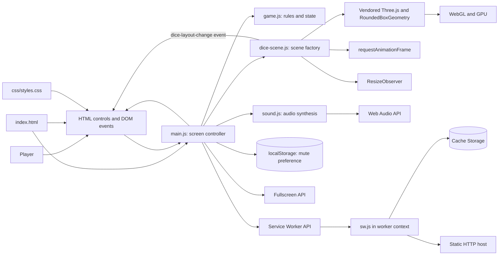

Arrows indicate dependency, invocation, or event flow as labeled, not inheritance. In particular, the rules module has no dependency on the scene, DOM, audio, or worker. The worker runs in a different execution context and communicates with the application indirectly by serving fetch requests; it does not exchange game-state messages with the controller.

## Module Descriptions

### Game Rules Module

[game.js](../javascript/html5/src/game.js) exports `CATEGORIES`, `createGame`, `rollTurn`, `toggleHeld`, `scoreCategory`, `submitScore`, and `getTotals`.

`createGame()` returns a fresh state with 13 unused scores, initial display values `[1, 2, 3, 4, 5]`, no holds, zero rolls, zero completed turns, and no bonus. Those initial dice are placeholders, not a scored roll.

`rollTurn(state, random)` generates a new dice array and increments the roll count. On the first roll every die is randomized; on later rolls held indexes retain their existing values. The injected random function makes deterministic tests possible. If all dice are held, a permitted roll still increments the count without generating new face values. A finished game or third-roll state returns unchanged.

`toggleHeld(state, index)` clones the hold array and flips one flag only after roll one or two. Holding is unavailable before the first roll, after the third roll, and after game completion.

`scoreCategory(categoryId, dice)` validates the dice and computes a category preview. Upper categories sum matching faces. Lower categories use frequency groups, distinct consecutive values, or the total dice sum. A valid category can score zero.

`submitScore(state, categoryId)` enforces an active rolled turn and an unused category. It records the selected score, checks the repeat Five of a Kind bonus, increments completed turns, clears holds, and resets rolls to zero. The dice values remain available for display. The thirteenth recorded category marks the game finished.

`getTotals(state)` derives upper and lower sums, the 35-point upper bonus at 63 points, the accumulated repeat bonus, and the grand total. Totals are not independently stored in state.

Private helpers `validateDice` and `hasStraight` enforce face validity and detect consecutive unique values. Transition functions replace the affected state data rather than mutating the input. The module is not entirely free of nondeterminism: the default `rollTurn` random source is `Math.random`.

### Screen Controller Module

[main.js](../javascript/html5/src/main.js) is the application's entry module. Its module-level variables are `game`, `diceScene`, `lastMessage`, and `soundMuted`. It queries the static DOM once, constructs the scene, installs event handlers, registers the worker when supported, and performs the initial render.

`render()` derives totals and display state, updates turn and roll labels, controls the game-complete panel, and shows the framed translucent start overlay only when `rolls === 0` and the game is unfinished. It then rebuilds dice controls and scorecard rows.

`renderDiceControls()` creates five accessible buttons. It uses `diceScene.getDieLayout()` when available to align rectangular interaction areas with the projected dice, not arbitrary fifths of the canvas. Each click closes over the logical die index and calls `toggleHeld`. A `dice-layout-change` canvas event rebuilds the controls after resizing. Numeric fallback controls work without a scene.

`renderScoreSheet()` groups the category rows into upper and lower sections. Unused categories become selectable after a roll; each suggestion is computed by `scoreCategory`. CSS frames available suggestions with dashed rectangular borders. Recorded categories show their committed score and cannot be selected again.

`scoreTurn()` commits a category and constructs the next-turn or repeat-bonus message. `startNewGame()` replaces the entire game state and clears that message. It asks the scene to animate the initial display values but does not count this reset animation as a game roll.

The roll handler performs the logical roll first, sends the resulting dice and held flags to the scene, requests sound, and renders the new screen. There is no animation-complete gate: values and previews update immediately, and another permitted action can occur before animation finishes.

The keyboard handler forwards `Space` to the roll button and `F` to fullscreen when the event target is outside a button. When focus is on a button, native button keyboard behavior is left intact. Fullscreen changes update the icon and accessible label. Before unload, the scene is disposed if one exists.

### Dice Scene Module

[dice-scene.js](../javascript/html5/src/dice-scene.js) exports `createDiceScene(canvas, initialValues)`. It returns a small closure-backed object with `getDieLayout`, `roll`, and `dispose`; renderer details stay private.

The factory constructs one `WebGLRenderer`, a `Scene`, a `PerspectiveCamera`, hemisphere and directional lighting, and a shadow-receiving ground plane. Five meshes share a rounded-box geometry and six face materials. Six pip textures are drawn programmatically on 2D canvases and converted to Three.js textures. No external dice image downloads are required.

`FACE_ROTATIONS` maps each logical value to a final orientation. `PIP_LAYOUTS` describes texture pip positions. `rollingRotation` adds whole revolutions to the final orientation so a visual spin still ends on the already-selected face.

`roll(values, held)` replaces the current animation record, capturing its start time, randomized duration of 720 to less than 1140 milliseconds, held-mask snapshot, and starting and ending transforms. A held die in an interrupted animation is settled to its previous target before the new animation begins. Held dice are skipped by subsequent animation frames.

The `requestAnimationFrame` loop interpolates rotations with cubic easing and adds a sine-shaped vertical hop to unheld dice. It renders continuously, including while there is no active roll animation. This is presentation animation, not a rigid-body physics simulation; mesh movement does not calculate game outcomes.

`ResizeObserver` monitors the canvas container. Resizing updates renderer dimensions, camera aspect, and die spacing and scale, then emits `dice-layout-change`. `getDieLayout()` projects resting die centers to normalized horizontal coordinates and returns a `left` and `width` for each control. Initial screen rendering queries this layout directly, so it does not depend on catching the factory's first resize event.

`dispose()` stops future frame processing, cancels the scheduled frame, disconnects the observer, and disposes shared geometry, textures, materials, ground resources, and renderer. The controller invokes it once on `beforeunload`.

### Sound Module

[sound.js](../javascript/html5/src/sound.js) exports `playRollSound(muted)`. It exits without audio work when muted, outside a browser, or when neither `AudioContext` nor the prefixed browser alternative is available.

A module-level audio context is created lazily and reused. If suspended, resume is requested. Each roll schedules a 0.2-second decaying noise buffer through a low-pass filter and gain envelope, plus four sine-oscillator impact sounds with their own gain envelopes. These nodes connect to the context destination, the browser's audio output.

Sound is synthesized in the browser; there are no audio assets. Its randomized samples and tones do not affect game state. The module does not expose a shutdown method, and asynchronous audio-context resume is not awaited by the screen controller.

### Offline Worker and App Metadata

[sw.js](../javascript/html5/src/sw.js) is a classic service worker, not an imported ES module. It installs a named asset cache, claims clients during activation, and applies a cache-first fetch policy to same-origin GET requests. It does not store game turns or scores.

The source worker explicitly lists unbundled modules, the icon, the manifest, and vendored Three.js files. The production worker is generated separately by the Vite build plugin and lists emitted build assets instead. Both policies are described in [Deployment and Offline Operation](#deployment-and-offline-operation).

[manifest.webmanifest](../javascript/html5/src/manifest.webmanifest) declares the app name, relative start URL and scope, fullscreen display preference, unrestricted orientation, theme colors, and SVG icon. It supplies launch metadata; it is not the game controller or an offline cache implementation.

## Data Model and Class View

### State Records and Invariants

| Record or Field | Meaning and Invariant |
| --- | --- |
| `GameState.scores` | Category ID to number or `null`; `null` means unused, while zero is a committed zero score. |
| `GameState.dice` | Five integer values in the range 1 through 6. |
| `GameState.held` | Five boolean flags, indexed identically to `dice`. |
| `GameState.rolls` | Rolls used in the active turn, from 0 through 3. |
| `GameState.turn` | Completed scored turns, from 0 through 13; not the current one-based screen label. |
| `GameState.bonus` | Accumulated repeat Five of a Kind bonus, awarded in 100-point increments at score submission. |
| `GameState.finished` | True after the thirteenth submitted category. |
| `Category` | `id`, `label`, `section`, and an upper-category `face` when applicable. |
| `ScoreTotals` | Derived `upper`, `lower`, `upperBonus`, `repeatBonus`, and `total`. |
| `DieLayout` | Normalized horizontal `left` and `width`, converted to percentages by the controller. |
| `RollAnimation` | Presentation-only timing, held flags, and start/end transforms; not game state. |

The following UML-style class view describes record shapes and public interfaces. Names such as `GameState` and `ScoreTotals` are documentation names for plain objects, not constructors defined in the source.

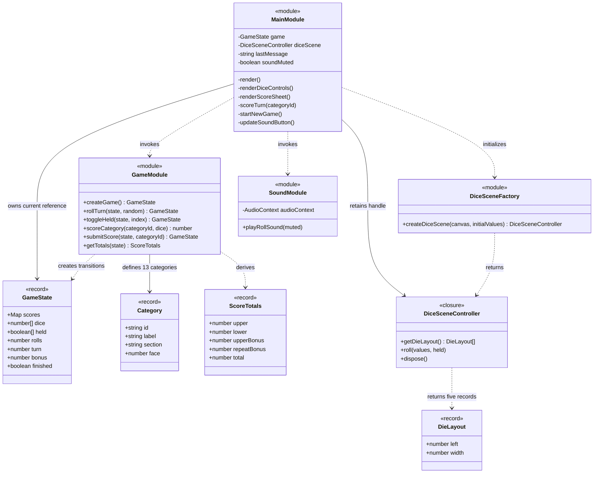

### Graphics Object Composition

These classes are provided by Three.js; the diagram shows ownership in the factory's closure, not application inheritance. Geometry and materials are shared by the five dice rather than recreated for every roll.

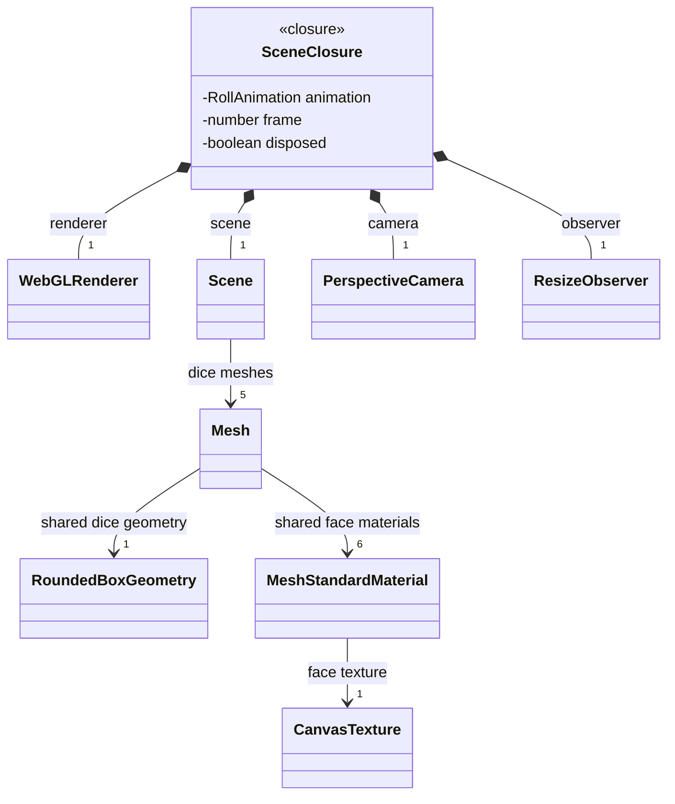

The ground is an additional mesh with its own plane geometry and material. Lighting objects are also scene children; they are omitted from this compact composition view, but described in the scene module section.

## Use Cases

The primary actor is the player. The browser supplies rendering, audio, fullscreen, storage, and optional installation capabilities. A static host supplies files but does not arbitrate moves.

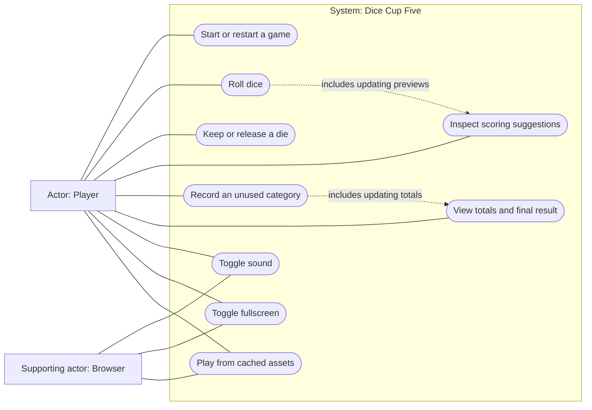

| Use Case | Preconditions and Outcome |
| --- | --- |
| Start or restart | New game and play-again controls reset all categories, holds, rolls, turns, and bonuses. The mute preference is retained. |
| First roll | Unfinished game with zero rolls; all five dice receive new values and scoring suggestions become available. |
| Reroll | One or two rolls used; held values are retained and other dice are randomized. |
| Keep or release | One or two rolls used; a selected logical index toggles its hold flag. |
| Record a category | At least one roll, unfinished game, and unused category; the turn ends even if the score is zero. |
| Finish game | The thirteenth category is recorded; further rolling and scoring are unavailable until restart. |
| Offline play | A successful earlier cache installation and a supported secure-origin worker context; no ongoing game-state synchronization occurs. |

## Activity and Flow Diagrams

### Turn Activity

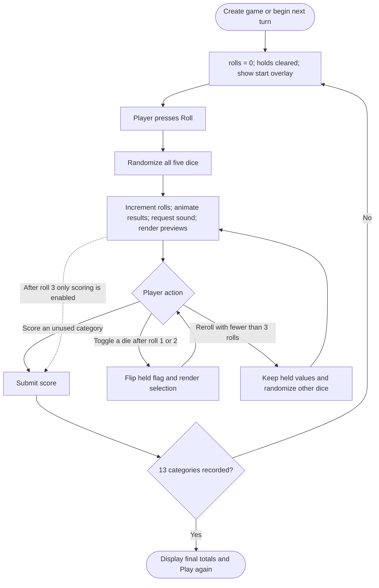

The controller disables impossible UI actions, while the rules module also guards transitions. The diagram abstracts the user waiting between actions; it does not imply an automatic category choice after the third roll.

### Score Submission Flow

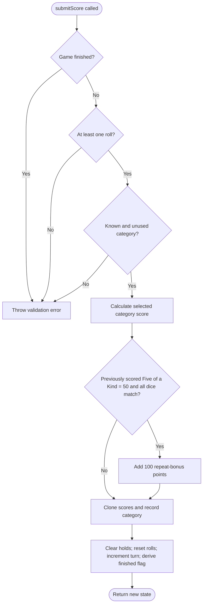

The upper-section bonus is not committed by `submitScore`; it is recalculated by `getTotals`. A repeat bonus is committed once when a turn is scored, not on every click of the roll button.

## State Charts

### Logical Game and Turn State

```mermaid
stateDiagram-v2
    [*] --> Ready
    Ready: Unfinished; rolls = 0
    RollOne: Unfinished; rolls = 1
    RollTwo: Unfinished; rolls = 2
    RollThree: Unfinished; rolls = 3
    Finished: turn = 13; finished = true
    Ready --> RollOne: rollTurn / roll all dice
    RollOne --> RollOne: toggleHeld / flip selection
    RollOne --> RollTwo: rollTurn / retain held dice
    RollTwo --> RollTwo: toggleHeld / flip selection
    RollTwo --> RollThree: rollTurn / retain held dice
    RollOne --> Ready: submitScore [completed turn less than 13]
    RollTwo --> Ready: submitScore [completed turn less than 13]
    RollThree --> Ready: submitScore [completed turn less than 13]
    RollOne --> Finished: submitScore [completed turn is 13]
    RollTwo --> Finished: submitScore [completed turn is 13]
    RollThree --> Finished: submitScore [completed turn is 13]
    RollOne --> Ready: new game
    RollTwo --> Ready: new game
    RollThree --> Ready: new game
    Ready --> Ready: new game
    Finished --> Ready: new game or play again
```

`RollThree` and `Finished` ignore further roll requests at the rules level. Hold requests outside `RollOne` and `RollTwo` return the unchanged state. Invalid score submissions throw rather than entering another game state. UI handlers normally avoid those submissions by disabling controls.

### Independent Presentation Lifecycle

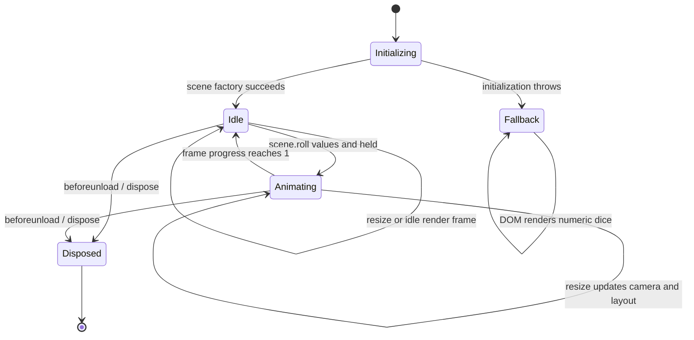

Logical state and presentation state are independent. Scoring or starting another roll need not wait for `Animating` to finish. A zero-roll new-game screen can temporarily animate placeholder dice beneath the start overlay.

## Object Message Exchange Scenarios

Lifelines identify runtime roles, including plain module objects and browser services. Dashed return arrows indicate values or asynchronous completion, not a separate RPC protocol.

### Startup and Rendering Fallback

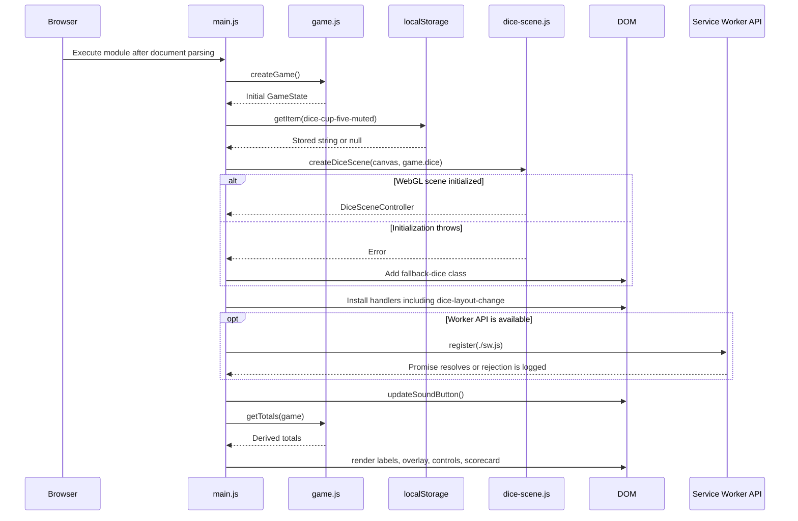

Worker registration is asynchronous and is not awaited before rendering. The scene's initial resize occurs during factory creation; the subsequent screen render obtains current layout directly from the returned controller.

### Keeping Dice and Rerolling

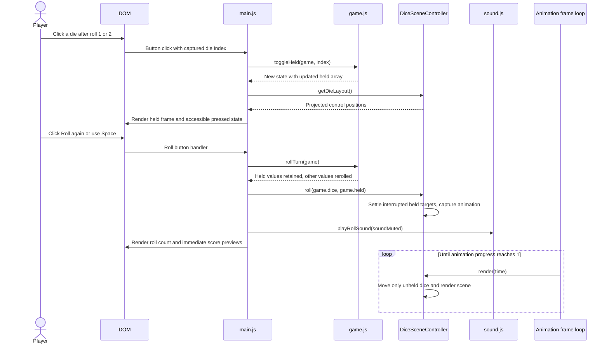

Selecting a held die again follows the same `toggleHeld` exchange and releases it. Selection areas come from projected mesh positions, so a click on a rendered die corresponds to the intended logical index. The scene's held-mask copy cannot change when a later state object is created.

### Category Submission, Bonuses, and Completion

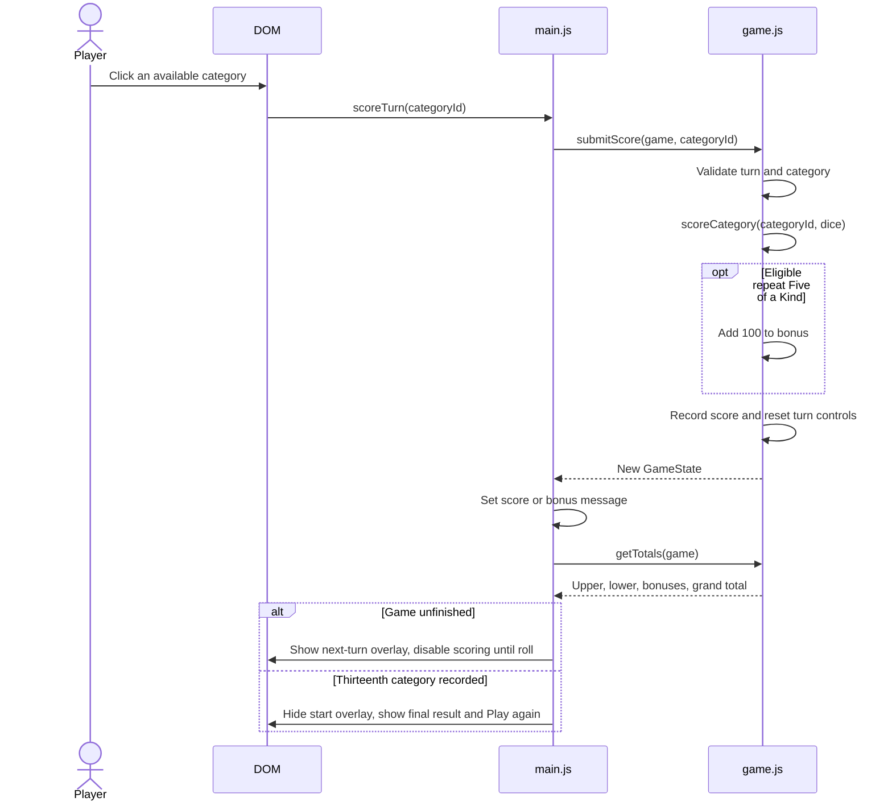

### Resize and Selection Alignment

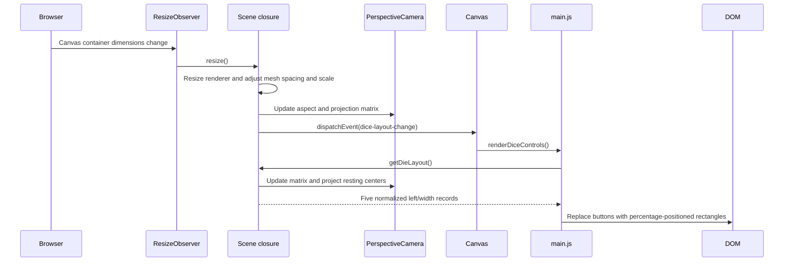

The event communicates that layout is stale; it carries no game-state mutation. A container with zero width or height causes `resize()` to return without updating the scene.

### Mute and Audio Scheduling

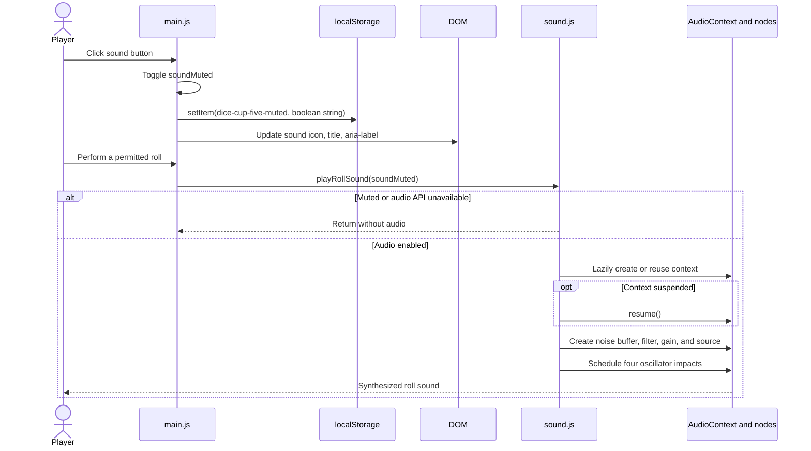

Audio resume and node playback do not block the game transition or DOM rendering. The preference is read again when the page starts, but a page reload does not restore a game.

### Fullscreen and Restart Controls

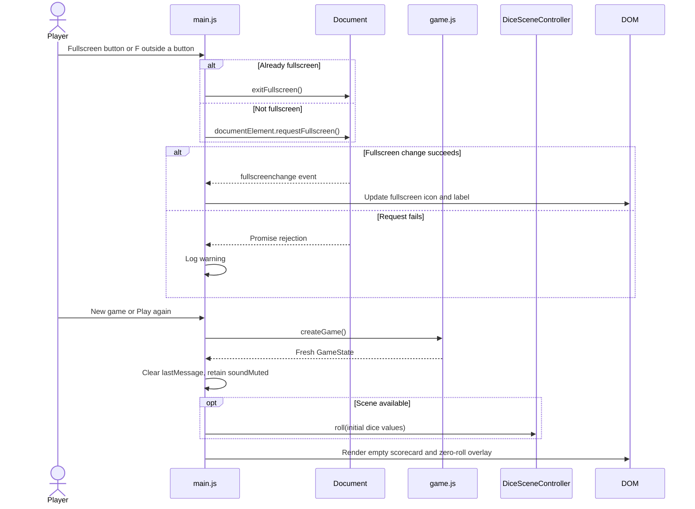

Restart is immediate; there is no confirmation dialog or save operation. Fullscreen is an optional browser capability and does not change the logical game state.

### Graphics Shutdown

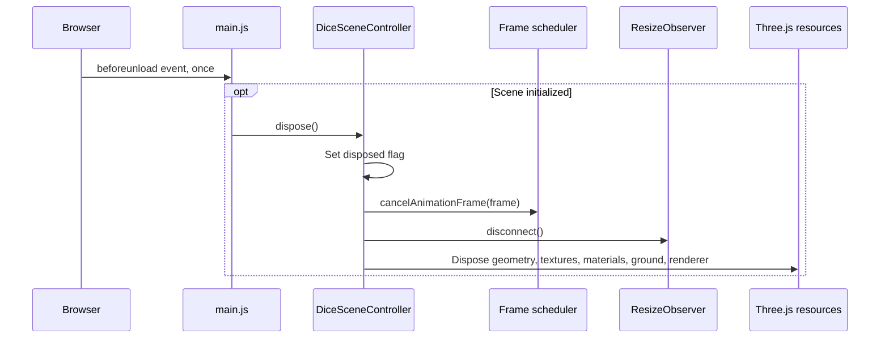

The unload path releases scene resources; it does not serialize the game or dispose the reused audio context explicitly.

## Deployment and Offline Operation

### Deployment View

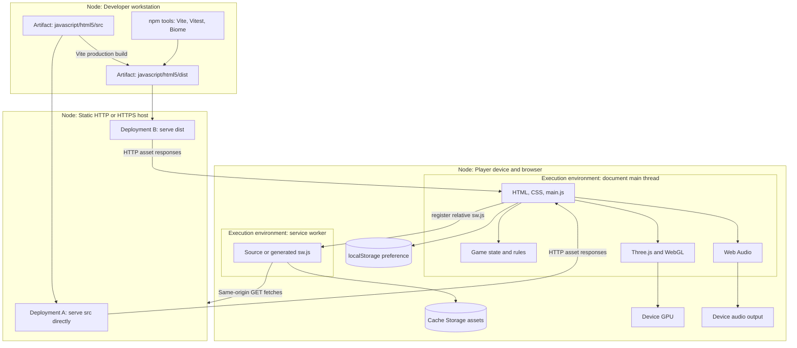

The two hosting modes are alternatives, not two servers required for one game. Node.js and npm are development/build dependencies; a player only needs a compatible browser and a host serving the files.

### Direct Source Hosting

Serve the source directory as the web root or as a consistently mounted subdirectory. The page imports relative ES modules, including local Three.js. A server must deliver JavaScript with an appropriate MIME type. Opening the document using `file://` is not the supported substitute for an HTTP server.

No dependency installation or bundling is required by the browser for this mode. The source worker currently uses cache name `dice-cup-five-source-v6` and an explicit precache list. A newly added runtime asset must be considered for that list if it should be available offline.

### Vite Development and Production Build

Vite's configured root is `src`, `publicDir` is disabled, and `base` is `./`. The production output directory is `dist`, which is emptied before a build. The manifest and icon are processed as assets.

The build-only `offlineWorker()` plugin copies the Three.js license, adjusts emitted manifest icon references, collects emitted HTML/JavaScript/CSS/SVG/manifest assets, and emits a generated `sw.js`. That worker currently uses cache name `dice-cup-five-v2`. Its asset list matches build filenames rather than the unbundled source paths.

The development server is convenient but not a third game architecture. A registered source worker may cache development responses; it is not an HMR-aware cache policy. Clear or unregister the worker when stale assets interfere with development or when testing a different deployment mode.

### Worker Lifecycle State Chart

```mermaid
stateDiagram-v2
    [*] --> Installing
    Installing: Open named cache and add precache assets
    Installing --> Installed: Precache promise resolves
    Installing --> Failed: Precache promise rejects
    Installed --> Activating: Browser advances lifecycle; skipWaiting requested
    Activating: Delete other dice-cup-five caches and claim clients
    Activating --> Active: Activation work completes
    Active --> Active: Handle same-origin GET fetches
    Active --> Replaced: New worker version activates
    Replaced --> [*]
    Failed --> [*]
```

This chart summarizes the browser's lifecycle and the worker's event handlers. Existing active workers can continue serving a page while another worker is being installed. `skipWaiting()` and `clients.claim()` request accelerated activation/control; they do not make network requests or installation universally synchronous.

### Cache-First Fetch Exchange

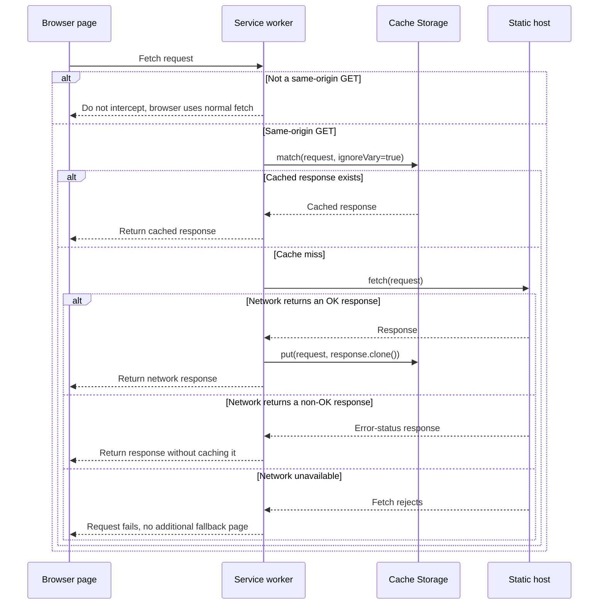

The worker returns a cached response without background revalidation. Writes on network misses are initiated without being awaited as part of the response chain. Cache names therefore matter for updates: a changed worker can activate, but unchanged cache keys may still return previously cached asset content.

Service workers require browser support and a secure context, normally HTTPS or localhost. First-load offline use is not possible without an earlier successful installation. Activation deletes other caches whose names begin with `dice-cup-five-`; deployments sharing one origin should consider that shared cache namespace. There is no custom install prompt or application `postMessage` channel.

## Quality Attributes and Verification

| Attribute | Current Mechanism and Boundary |
| --- | --- |
| Portability | Relative ES-module imports, locally vendored runtime dependency, direct static hosting, optional Vite build. |
| Testability | Rule functions accept state records; randomness can be injected; DOM and audio behavior are exercised through jsdom and mocks. |
| Accessibility | Semantic buttons and fieldsets, accessible labels, held `aria-pressed` state, live roll counter and turn hints, focus-visible styling. |
| Responsiveness | CSS breakpoints plus camera/container resizing and projected die-control positions. Rule descriptions use an intrinsic-width desktop column. |
| Resilience | Numeric fallback on scene initialization failure, silent no-op when audio is unavailable, logged worker/fullscreen failures. |
| Offline availability | Precached application assets and same-origin cache-first fetching; no persistence of active games. |
| Rendering cost | Five meshes share geometry and materials; pixel ratio is capped at 2. The frame loop still renders while idle. |
| Separation of concerns | Rules decide values and points; scene animation and synthesized audio never determine those values. |
| Dependency provenance | Three.js is vendored with its own documentation and license, including license emission in the build. |

From `javascript/html5`, `npm test` runs the test suite, `npm run coverage` checks coverage, and `npm run check` runs Biome over the configured source and configuration files. `npm run build` and `npm run preview` exercise production artifact creation and local serving.

Vitest discovers `test/**/*.test.js` and uses jsdom. Coverage includes the game, main, and sound modules, with 96% thresholds for branches, functions, lines, and statements. The scene, service worker, vendored Three.js, and build plugin are not included in those thresholds.

The current automated suite verifies game rules and guards, held values, totals and bonuses, a complete screen workflow, projected-layout consumption and resize events through a scene mock, the start overlay's lifecycle, utility controls, and audio scheduling through mocks. A mocked scene does not prove actual WebGL rendering, physical click alignment, or GPU resource behavior.

Browser-level checks should cover rendered dice and actual pointer selection at desktop/mobile widths, unchanged held meshes and values during rerolls, score description fit, optional browser API failures, direct source hosting, production hosting, and controlled offline/update scenarios. These are verification responsibilities, not claims of additional test files in the repository.

## Maintenance Considerations

- **Preserve direct hosting:** do not introduce bare runtime package imports or build-only asset references into the source entry path without providing a browser-resolvable alternative.
- **Keep state authoritative:** changes to scoring and legal turn actions belong in the game module, not the scene animation loop or CSS.
- **Keep dice indexes consistent:** state arrays, meshes, projected layouts, button callbacks, and held-mask entries must retain the same five-index ordering.
- **Maintain both worker variants:** source precache changes and generated build-worker behavior are separate concerns. Review cache-version changes and same-origin cache deletion when deploying updates.
- **Keep previews and committed scores distinct:** `null` is unused; a numeric zero is already scored. Repeat bonuses are evaluated on submission, and upper bonuses are derived from totals.
- **Understand synchronous UI updates:** the controller replaces DOM controls after each render and does not await roll animation. Adding animation locks or stable-element reconciliation would change this interaction contract.
- **Do not mistake cached assets for saved games:** game restoration, multiplayer, a backend, and custom installation UI are not implemented.
- **Handle browser boundaries deliberately:** WebGL initialization is caught, but later renderer failures are not converted automatically to fallback. Local storage access is not wrapped against storage-denied errors, and audio resume is not awaited or explicitly caught.
- **Separate documentation from runtime:** AUTHORS files, rules, this document, tests, and editor settings do not participate in game-state transitions. Whether deployment includes extra files is a hosting decision.
